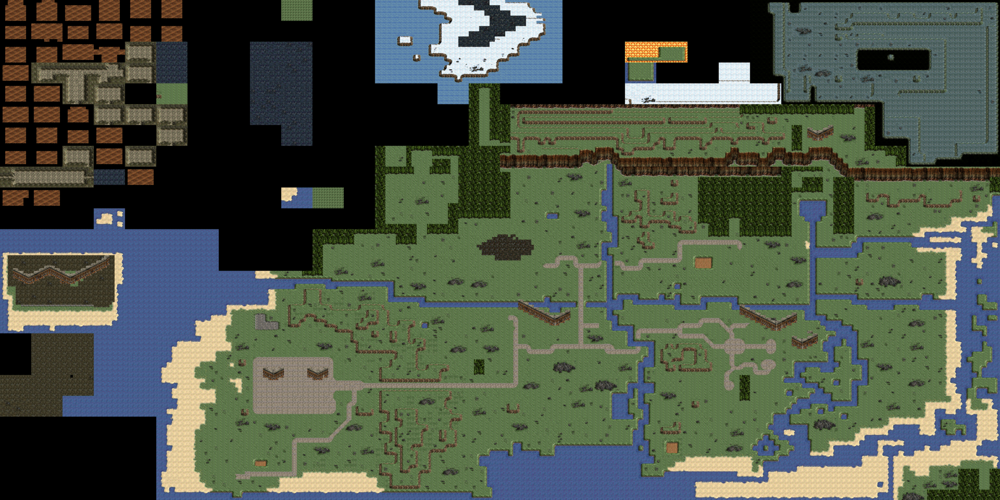

# Dink Smallwood remaster: plan from pre-production to live

## Context

You want to remaster Dink Smallwood (1997, RTsoft) to modern standards in Unreal Engine with realistic graphics authored in Blender, recognisably the same game, base game first and expanded content after. The repo is a fork of the open-source Dink Smallwood HD engine with the complete original data, so the whole job can be measured from it.

**Status:** plan approved 5 Nov 2026. Supporting material: [content bible](bible/README.md), [reference images](reference/), [extraction tools](../../tools/).

**Your decisions:** solo or 2-3 people, about 20 hours a week, strong in both code and art; free fan project; third-person camera behind Dink; PC first (Windows, Linux, Steam Deck); the 1997 script kept fully verbatim; AI tools and MCP servers used throughout. You have pre-approval from the rights holder and handle that correspondence yourself.

**What that adds up to:** third-person plus realistic is a new 3D game built on Dink's content. The honest size of the base game is about 40 person-months with the cuts and AI assistance in this plan (52 without AI, 85 with no cuts; all ±30%). At 20 hours a week that is roughly 6-7 years solo or 2.5-3 years for three people. The plan is built to make that survivable: automate from the original data, source everything that is not uniquely Dink, release a demo early and recruit from it, and re-measure the schedule at the first milestone.

## What the review found

Four research passes read all 380 scripts, the engine source and the data files; I extracted and viewed all sprite families, tile sets and UI, and rendered the whole world map from `map.dat`.

| Area | Measured |
|---|---|
| World | 32x24 grid of fixed screens, 644 used (570 outdoor, 74 indoor), each 12x8 tiles. 5,846 placed sprites (average 9 per screen), 93 warps, 20 scripts with locked-room fights |
| Scripts | 380 DinkC scripts, 2,125 spoken lines, 115 dialog menus with 359 options, 63 global variables; `&story` 0-16 is the spine |
| Regions | Stonebrook, Terris, Goodheart Castle, KernSin + Goblin Sanctuary + Cast camp, Windemere, Joppa Isle, Edge of the World, Darklands, Koka Isle, secret snow castle, caves |
| Cast | About 60 named NPCs from 11 recoloured archetypes. Enemies: pillbug, bonca (3), slayer, dragon, goblin (3), slime (3), stone giant; boss Seth. Animals: duck, pig, fish |
| Player kit | Fists, 3 swords, throwing axe, 3 bows, bombs, hyper boots; Fireball, Acid Rain, Hellfire, Mordavia scroll; Attack/Defense/Magic, +1 stat per level, max level 32 |
| Art | 3,569 sprite frames (pre-rendered 3D), 41 tile sheets, 13 building kits, stone-and-gothic UI |
| Audio | 58 effects, 33 MIDI and 18 OGG tracks |
| Open hooks | Furrier who sells nothing, pawn shop that never stocks, unobtainable slayer claw, sealed Murkwood Forest, PortTown and pirates (named, never built), cut "boat with Death", house for sale, unused spike enemy and green slime |

Findings that shape the plan:

1. **Rights.** `LICENSE.md` clause 4: the name "Dink Smallwood" may not be used to promote even the use of derived software without Seth Robinson's authorisation. Clause 5a: original graphics, maps and scripts are zlib-style licensed (an older 2003 notice on his site says modified media needs permission, so confirm with him). Clauses 5c/5d: some sound effects have unclear status and the full media package is only authorised for the official app. The original music was never RTsoft's to license. So: all audio is new, and the HD engine is linked to, not bundled.
2. **The world is small and flat.** At sprite scale the whole map is about 480 m x 240 m with no elevation; cliffs are just tiles. Islands and the Darklands touch the mainland on the grid and are separated only by collision, so in third person you would see straight across.
3. **The save model is tiny.** The original saves only player stats, inventory, the global variables and a per-screen table of "this sprite is dead/changed". Copying that model means the 3D world never needs to save actors.
4. **Verbatim has a distribution cost.** The scripts include a staged beating the player can encourage (`s2-auntp.c`, `s2-jack.c`), incest and child-abuse innuendo (`s2-auntp.c`, `s1-h3-l.c`) and killable children (`s1-lg.c`, `s7-dgirl.c`). Kept as-is in realistic 3D, expect storefront refusals.

## 0. Rights and identity (before production)

1. Permission: pre-approved, handled by the project owner. Keep the written approval with the project records and have it cover three things before any public demo: use of the name, modified use of the original media, and the credit wording required by clause 2.
2. Asset ledger from day one: every third-party or generated asset with its source, licence, and proof it can be redistributed free.

## 1. Pillars

1. **Same game, new eyes.** Every base-game quest, NPC, line, shop and secret exists, in the same place relative to everything else.
2. **Dink is still a jerk.** Almost anything can be hit, talked to, pushed or burned, and it answers back.
3. **Grounded world, absurd people.** Realistic materials, light and landscape; faces, proportions and animation carry the comedy.
4. **Small and dense.** Something worth looking at every 20 seconds of running.
5. **Base game is sacred, expanded content is additive** and lives in a separate plugin that can be switched off.

## 2. Engine and architecture

- **Unreal Engine 5.8, locked.** It is the last planned UE5 major release; UE6 early access is not due until late 2027. Never migrate mid-project.
- **Rendering:** Nanite, Lumen (lighter GI mode for Steam Deck), Virtual Shadow Maps, TSR upscaling. Deck performance is proven on a test scene in pre-production, before art is built on it.
- **World:** World Partition + HLOD, Landscape, Water, PCG for flora and scatter.
- **Code:** C++ and text data first; Blueprints only for composition and tuning (agents work on text, see section 9). No Gameplay Ability System: three stats, 16 items and 8 spells need a small custom stats-and-actions component; GameplayTags are used throughout.
- **Project plugins:**

| Plugin | Holds |
|---|---|
| `DinkCore` | Quest facts (keyed by original variable names), world overrides (port of the original per-screen sprite table), screen volumes, stats and damage, inventory, interaction, save |
| `DinkNarrative` | Ink wrapper, cutscene director, barks, conversation and stage cameras |
| `DinkImport` (editor) | JSON-to-level importer, validators, command-line entry points |
| `DinkParity` (dev) | Automated tests and coverage reports |
| `DinkExpanded` | All non-original content |

- **The screen survives as a logical unit.** Each original screen becomes a volume that drives music, enemy reset, quest-state variants and locked fights. Every imported actor carries its origin ID (`S412_P03` = screen 412, sprite 3) and script name.
- **AI:** four State Trees cover every original behaviour (wanderer, chaser, ranged caster, boss). Navmesh movement, short attack wind-ups, at most two attackers at once.
- **Dialogue:** Ink via the Inkpot plugin; fallback is compiling Ink to JSON offline. Spiked on Linux in pre-production.
- **Version control:** Git + LFS on a self-hosted Forgejo (file locking), `.blend` sources in a separate LFS repo. This repo stays as reference engine, extraction tools and design docs.
- **Linux caveats to settle in pre-production:** editor stability on your compositor, whether Fab works in the Linux editor, and Windows packaging (likely needs a Windows machine or VM).

## 3. World conversion

- **One continuous outdoor world with per-region scale:** about 4x in settlements, 2.5-3x in wilderness, 1.5-2x for interiors. A table (`regions.toml`) sets scale, offset and rotation per region and is tuned by running the greybox.
- **Regions are pulled apart.** Joppa, Koka Isle, the Darklands and the snow castle move out to sea or behind mountains; the 124 unused grid cells become sea and mountain. The cliff escarpment, tree-lines, relief and fog block long sightlines.
- **Elevation is hand-authored**; the original has none.
- **Interiors** are streamed sub-levels behind doors, built from one modular 2 m kit with 3.5 m ceilings and a shortened camera arm.
- **Locked fights** become encounter volumes with a thorn barrier (thorns are already an original hazard) that drops when the tagged enemies die.
- **Scripted burnable trees and bombable rocks** must look different from the thousands of ordinary ones: dry trees, cracked rocks.
- **Save machines** stay at their 10 original spots and double as fast travel once used; autosave is added.

## 4. Gameplay in third person

| System | Original | Remaster |
|---|---|---|
| Movement | 8 directions, screen flips | Analogue, sprint, dodge roll, seamless |
| Melee | One swing | Short combo per weapon, soft lock-on, telegraphed enemy attacks, off-screen indicators |
| Bow | Hold to charge | Shoulder aim with reticle, same charge; bow lore shown as crit chance |
| Magic | Recharge set by Magic stat | Same formula (seconds = cost / (10 x Magic)), aimed or quick-cast at lock target |
| Stats and levels | +1 Attack, Defense or Magic per level | Unchanged |
| Hit anything | Per-object scripts | Reaction sets by object type, so every prop has a line by default; original lines override |
| Difficulty | One | Story, Classic, Hard |

The original damage formula is ported into one function and the original numbers ship as the "Classic" data set. Stat ratios are kept; absolute values are re-tuned for 3D in a separate data set.

## 5. Story, dialog and content policy

- **Source of truth:** every line is converted from DinkC into Ink, one file per original script, with the original variable names as the fact store.
- **Cutscenes:** most run through a director that executes the script's own beats (move, say, wait, fade) with an automatic "stage camera" framing the original screen from a high three-quarter angle, which is also a nod to 1997. Sequencer is reserved for about six scenes: the bully, the house fire, the parade, the King, Seth, the ending.
- **Presentation:** speaker-coloured floating text kept as the subtitle style. Text-first; Dink's barks are the first voice target.
- **Bug fixes only:** typos, inverted conditions and wrong-speaker lines are fixed and logged against the original file. Dead scripts stay out, including the unused scene with pasted song lyrics.
- **Fully verbatim (your decision):**
  - Every reachable line, option and killable NPC ships as written.
  - Primary distribution is self-hosting and itch.io with an adult-content flag. Steam is a bonus that may refuse or delist; nothing depends on it.
  - Age gate and plain content notice on first launch and on the download page.
  - Scenes are staged no more graphically than 1997 showed them (the beating is punch effects and text; no added gore or close-ups).
  - The content bible keeps a register of every sensitive line with its file, so any scene can be revisited later without re-reading the scripts.

## 6. Art direction and pipeline

**Look:** stylised realism at Fable/Gothic distance, not photoreal faces. Photoreal heads delivering 2,125 unvoiced lines look dead and fight the comedy. Dink keeps his silhouette and colours (red-brown hair, grey-blue sleeves, brown jerkin and backpack, olive trousers, red bracers); buildings keep their 1997 shapes.

**Tools (free):** Blender 5.2 LTS, MPFB2 for base human bodies, Material Maker/ArmorPaint, Krita, UE for materials, lighting and VFX.

| Asset | Approach | Count |
|---|---|---|
| Ground, rock, foliage | CC0 libraries (Poly Haven, ambientCG) and Fab where the licence allows; PCG placement | 8 biomes |
| Buildings | Bespoke modular kits, one per original family | 13 |
| Props | Generated or sourced, cleaned in Blender, shared trim-sheet materials | about 150 |
| Humans | Two adult bodies and a child on one UE-compatible skeleton; about 11 modular outfits, head morphs and tints (the original's recolour trick in 3D) | about 60 named |
| Dink, ducks, pillbug, bonca, slayer, dragon, Seth, save machine | Fully bespoke: these are the identity | 8 |
| Other creatures | Shared rigs: goblins on the humanoid rig, pig and bonca on one quadruped rig, slimes by shader | 6 |
| Animation | Motion matching for Dink's locomotion from Epic's free sample; hand-keyed combat and comedy; blendspaces for everyone else | - |

## 7. Audio

- **Music:** all new. Public-domain compositions among the original tracks are re-rendered with free instruments; the rest get new themes in the same mood. One theme per region plus battle, cave, Darklands, title.
- **Effects:** all 48 replaced (new generated effects; the earlier figure of 58 counted files the scripts never load); the signature ones stay recognisable (quack, pig, level-up, secret-found, save-machine hum).
- **Implementation:** MetaSounds, region music states with a combat layer, per-biome ambience and footsteps. Tools: Reaper or Ardour, Audacity.

## 8. Data pipeline

| Stage | Output | Automated? |
|---|---|---|
| 1. Extract (`tools/dinkex`, Python) | One JSON per screen, sequence table, walkability image per screen, sprite reference PNGs, parsed scripts | Fully. Needs a real DinkC parser (87 `goto`s, conditional menu lines) |
| 2. Classify | Tables mapping tiles and sprites to terrain types and prop classes (559 sprite frames; the top 100 cover 74% of placements) | By hand, machine-checked |
| 3. Analyse | True region boundaries from collision, warp graph, which script reads and writes which variable, locked fights, quest-state variants (164 sprites on 37 screens) | Fully |
| 4. Layout | `regions.toml` to world coordinates | Table by hand |
| 5. Convert scripts | Ink drafts with director tags, enemy/item/shop data, bark tables | Draft automatic, human check |
| 6. Import to UE | Landscape layers, blockers, placeholder actors, warps, spawners, screen volumes, cutscene markers; re-runnable without overwriting finished work | Fully |
| 7. Report | `coverage.csv`: every origin ID and script marked greybox / final / cut with reason | Fully |

Throwaway versions of stage 1 already reproduce 644 screens and 5,846 sprites. Format traps to honour: `hard.dat` is shorter than its struct and has out-of-range entries; collision value 2 is "low" (water, fences) that projectiles cross; the sprite `hard` flag is inverted; most enemies get their behaviour from their script, not the map; weapon scripts swap Dink's animation sets at run time.

**Parity checks, in order of value:** coverage report; generated tests that trigger an interaction and assert the variable changes the script predicts; a teleport bot that drives `&story` from 0 to 16; the HD engine as reference (builds with `./linux_setup.sh`, has a debug menu in `source/GUI/DebugMenu.cpp`).

## 9. AI-assisted production

- **Unreal:** UE 5.8 ships Epic's own MCP server in the editor (plugin id `ModelContextProtocol`, needs AllToolsets). Agents can spawn actors, set materials and lighting, and run automation tests.
- **Blender:** community MCP servers exist for 5.2 LTS but none is official. Headless scripts (`blender -b -P script.py`) are the dependable route for batch work; MCP is for interactive sessions.
- **Self-checking:** build, cook and test commands are written into the UE project's `AGENTS.md` so every agent task ends in a test run. This repo already uses `AGENTS.md` that way.

| Work | AI does | Human still does |
|---|---|---|
| Extractor, importers, C++ systems, tests | Most of the writing | Architecture, review, play-testing |
| DinkC to Ink (380 scripts) | Converts with the original alongside | Verifies against the reference game |
| Concept art | Realistic takes on the original sprite sheets | Chooses and locks the art bible |
| Props and building parts | Image-to-3D (TRELLIS.2: MIT, runs locally; Hunyuan3D: better textures, stricter licence) | Retopology, UVs, scale, material consistency |
| Identity characters | A starting mesh at most | Sculpt, topology, rig, personality |
| Human body animation | Video-to-mocap (Rokoko Vision, FreeMoCap) | Clean-up, timing, all creature animation |
| Audio | Drafts only where the licence allows redistribution | Final choices; never clone a real voice |

Rules: every generated asset goes in the ledger with tool, model and licence; AI use is disclosed on the download page; nothing ships unreviewed against the art bible.

## 10. Roadmap

Effort is in person-months (160 hours). Calendar: one person at 20 h/week takes about twice the person-months; three people take about three-quarters of them.

| Phase | Effort | Solo | Three people | Delivers |
|---|---|---|---|---|
| 0. Rights and setup | 0.5 | 1 mo | 1 mo | Letter sent, ledger, UE project, source control |
| 1. Pre-production | 4 | 8 mo | 4 mo | Extractor, whole-world greybox, bibles, Dink v1, combat prototype |
| 2. Vertical slice: Stonebrook | 8 | 16 mo | 7 mo | Stonebrook final, `&story` 0-6, **public demo** |
| 3. Act 2: Terris, Castle, KernSin, goblins | 9 | 18 mo | 7 mo | `&story` 7-10 |
| 4. Act 3: Windemere, Joppa, the King | 7 | 14 mo | 5 mo | `&story` 10-13 |
| 5. Act 4: Edge of the World, Darklands, Koka Isle, snow castle | 6 | 12 mo | 5 mo | `&story` 14-16 = **alpha** |
| 6. Beta | 4 | 8 mo | 3 mo | Final art and audio, options, Deck pass, first expanded layer |
| 7. Launch 1.0 | 1.5 | 3 mo | 1 mo | Release build, pages, trailer |
| **Total** | **40** | **about 6.7 years** | **about 2.75 years** | |

**Gates (each must be checkably true):**

| Gate | Exit criteria |
|---|---|
| Pre-production | Written approval on file. Linux and Windows packages build. Deck holds frame rate on a final-quality test scene with 10 characters. One command regenerates the greybox with all 5,846 placements and 93 warps carrying origin IDs. All 380 scripts parse with zero errors. Ink works on Linux. Three regions run-tested and their scale fixed. |
| Vertical slice | Every Stonebrook screen and script is "final" in the coverage report. The bot passes `&story` 0-6. Saves survive a version bump. One of each at final quality: biome, building kit, outfit, enemy, spell, weapon, shop, locked fight, interior, director scene, Sequencer scene. Hours per screen and per character are measured and the schedule is re-based on them. 30 minutes on Deck without a crash. |
| Alpha | Bot completes `&story` 0-16 on a packaged build. Every origin ID is final, placeholder or cut with a reason. No original audio in the build. |
| Beta | No placeholders in base content. Performance met in every region on Deck. Licence audit of every shipped asset. Alpha saves load. Parity tests pass with `DinkExpanded` off. Ten outside testers finish the game. |
| Launch | No open crash or progression bugs. Packages built by script from a tagged commit. Credits complete. Save format frozen. Controller-only and keyboard-only completion verified. |

**Releases:** one public demo (Stonebrook), then at most one drop per act. Every public build creates save-compatibility and support work.

**If the team stays at one person after the demo:** stop at Acts 1-2 as a complete release and treat later acts as community-driven.

**Cut order:** voice, Koka Isle arena polish, snow castle, bespoke interiors, unique faces for minor NPCs.

## 11. Expanded content

All in `DinkExpanded`, behind a switch, and not started before the alpha gate.

| Wave | Content | Grows from |
|---|---|---|
| Beta | Clothing and armour slots, first sets from the Windemere furrier; pawn shop with rotating random stock; monster parts as trade goods | Furrier and pawn stubs, slayer claw |
| Beta | Reputation: towns react to hero or menace; the King's News poster reports your deeds | Existing "madman who kills pets" rumours |
| Beta | More hit and talk lines per prop and NPC; luck stat fed by fountain coins, driving crits and loot rolls | Fountain and furniture gags |
| Pack 1 | Spike enemy, green slime, biome variants, a boss for regions without one; spear, crossbow, shield | Unused sprites and scripts |
| Pack 2 | PortTown, the pirates, Blistering Pete's past, the ferryman | Named but never built |
| Pack 3 | Murkwood Forest, the goblin war, a peaceful route through the Sanctuary via George, the Smallwood family secret | Sealed-forest sign, wizard lore |
| Pack 4 | Player house in Terris, bigger duck arena and gambling, random road encounters | "House for sale", Koka arena, roadside robbery |

## 12. Main risks

| Risk | Mitigation |
|---|---|
| Art volume at a realistic bar | Sourcing rules in section 6; bespoke work only on identity assets |
| World is dull in third person | Whole-world greybox and scale tuning before any final art |
| Licence scope unclear later | Written approval on file covering name, media and credit; all-new audio |
| Linux toolchain friction | Settled as pre-production gate items |
| Storefront refusal over verbatim content | Self-host and itch.io first; content register allows targeted changes later |
| Burnout and creep | Demo early, recruit from it, no expanded content before alpha |

## 13. Where things are

| Path | Contents |
|---|---|
| `doc/remaster/REMASTER_PLAN.md` | This plan |
| `doc/remaster/bible/` | Content bible: story and quests, characters, bestiary, items, economy, audio cues, engine and file formats, architecture review. Start at `README.md` |
| `doc/remaster/reference/` | World map rendered from `map.dat`, sprite and tile contact sheets, sequence listing |
| `tools/` | Extraction and conversion pipeline (section 8) |

The Unreal project lives in its own repository once Unreal Engine 5.8 is installed; nothing in this repo depends on it.

## Sources checked

- [Unreal Engine 5.8 release coverage](https://pcgamer.com/software/unreal-engine-5-8-launches-with-improved-terrain-and-vegetation-tools-a-lumen-lite-option-for-faster-global-illumination-and-for-the-times-we-now-live-in-an-open-standard-plugin-for-llm-systems/) and [UE6 timing](https://www.gematsu.com/2026/05/unreal-engine-6-announced-with-rocket-league-reveal)
- [Unreal MCP in Unreal Editor (Epic docs)](https://dev.epicgames.com/documentation/unreal-engine/unreal-mcp-in-unreal-editor)
- [Blender 5.2 LTS](https://www.blender.org/releases/5-2/)
- [Inkpot (Ink for UE)](https://github.com/The-Chinese-Room/Inkpot) and [Yarn Spinner for Unreal](https://docs.yarnspinner.dev/yarn-spinner-for-unreal/unreal)
- [FreeDink on the 2008 data licence](https://www.gnu.org/s/freedink/about) and the [2003 source notice](https://www.codedojo.com/files/dink/license.txt)
- [AI 3D generation timeline](https://app.cinevva.com/guides/ai-3d-model-generation-timeline-2026), [AI mocap overview](https://www.youngju.dev/blog/culture/2026-05-16-ai-motion-capture-animation-2026-move-ai-cascadeur-deepmotion-wonder-studio-rokoko-plask-animatediff-runway-deep-dive.en)
